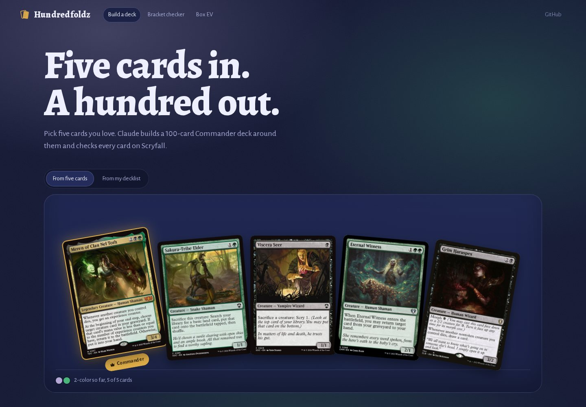
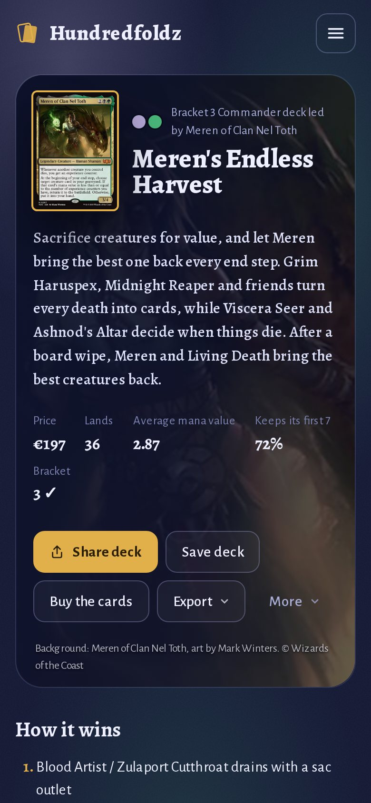

<div align="center">


# Hundredfoldz & MTG Master

**Five cards in. A hundred out.**

Pick five Magic cards you love and Claude builds a full, legal 100-card Commander deck around them,<br>
checked card by card on Scryfall. Powered by **MTG Master**, a Claude Skill for Magic: The Gathering.

[](https://github.com/M-Sahin/mtg-master/actions/workflows/tests.yml)
[](https://github.com/M-Sahin/mtg-master/actions/workflows/web.yml)
[](LICENSE)

**[Try Hundredfoldz](https://hundredfoldz.app)** · [Install the skill](#install-the-skill) · [Host your own](web/README.md#host-your-own)

<br>


</div>

## What's in this repo

| | |
|---|---|
| **[Hundredfoldz](https://hundredfoldz.app)** ([`web/`](web)) | A free, open-source Commander deckbuilder. Five seed cards and a bracket in, a complete deck out in one to three minutes, with every step shown live. |
| **MTG Master** ([`mtg-master/`](mtg-master)) | A Claude Skill that turns Claude into a pro-level Magic player, rules judge and deckbuilder for every format. Hundredfoldz builds its decks with it. |

---

## Hundredfoldz

### Pick five cards. Watch Claude build the other 95.

<table>
<tr>
<td width="50%"></td>
<td width="50%"></td>
</tr>
<tr>
<td><b>Five cards, a bracket, a budget.</b> Any five Commander-legal cards, a commander among them or not. Claude picks the commander if you don't.</td>
<td><b>Every step, live.</b> What Claude is looking for, every Scryfall search, and the list filling a 10×10 grid by role. You can leave the page: the build keeps going.</td>
</tr>
</table>

- **Checked, not guessed.** Every card is looked up on Scryfall. The server checks the deck before you see it: 100 cards, singleton, color identity, the bracket's Game Changers, mass land denial and extra turns, and early two-card combos from Commander Spellbook. A deck that fails goes back to Claude with the problems, and Claude fixes them.
- **The numbers that matter.** A mana curve and deck balance against the usual Commander counts. How often the mana works, from 4,000 simulated opening hands. What the deck costs, and whether any booster box is a cheaper way to get it (it almost never is).
- **Your deck, your way.** Complete a half-built deck to 100, or get up to 10 suggested upgrades for a finished one. Build only from cards you own. Set limits on creatures, lands, ramp, draw, removal, wipes or average mana value.
- **Take it anywhere.** Share a link, copy the list for Moxfield, Archidekt or MTG Arena, or open the whole list in a shop's cart. Tap any card for its price at Cardmarket, TCGplayer and Card Kingdom.
- **Your decks, kept.** Every deck lands in My decks: in your browser, or on every device with a free account (log in with an email link, no password).
- **Free to use.** Three free builds on Claude Haiku. After that, or for Sonnet and Opus, bring your own Claude API key: you pay Anthropic directly, about 25 cents a deck on Sonnet.

<table>
<tr>
<td></td>
<td></td>
</tr>
<tr>
<td><b>Verdicts first.</b> Each panel says what it found before it shows the chart.</td>
<td><b>Why it's in the deck.</b> Every card says what it does for the plan, and where to buy it.</td>
</tr>
</table>

### Made for your phone

<table>
<tr>
<td width="25%"></td>
<td width="25%"></td>
<td width="25%"></td>
<td width="25%"></td>
</tr>
</table>

Put your phone away mid-build and the deck is still there when you come back. On a phone the build screen follows Claude, and stacked cards pop out with a tap.

### Free tools, no key needed

<table>
<tr>
<td width="50%"></td>
<td width="50%"></td>
</tr>
<tr>
<td><b><a href="https://hundredfoldz.app/bracket">Bracket checker</a>.</b> Paste any decklist and get the lowest bracket it fits, the cards that decide it, and a legality check.</td>
<td><b><a href="https://hundredfoldz.app/ev">Box EV</a>.</b> What every booster box since 2020 is worth on average, and your chance of getting your money back, from 4,000 simulated boxes with daily prices.</td>
</tr>
</table>

### Host your own

Hundredfoldz is free and open source. Deploy your own copy in one click: visitors build with their own Claude API key, so the site itself needs no key. With a key of your own you can also give every visitor a few free builds (`FREE_BUILDS`).

[](https://vercel.com/new/clone?repository-url=https%3A%2F%2Fgithub.com%2FM-Sahin%2Fmtg-master&root-directory=web)

Docker and plain Node.js work too. [web/README.md](web/README.md) has every option: environment variables, accounts with Supabase, free builds, the bot check, Box EV data and the engine evals.

---

## MTG Master, the Claude Skill

**MTG Master** turns Claude into a pro-level Magic player, rules judge and deckbuilder. It answers rules questions with step-by-step reasoning and Comprehensive Rules citations. It builds and reviews decks for 60-card formats, Commander and Limited. Card text, legality and prices are checked against [Scryfall](https://scryfall.com) instead of being recalled from memory.

| | |
|---|---|
| **Cards** | Exact Oracle text, legality in every format, prices, rulings, and Scryfall searches like "cheap black removal in Pioneer". |
| **Rules** | Priority, the stack, state-based actions, replacement effects, layers, combat and Commander rules, answered the way a judge would. |
| **Constructed** | Standard, Pioneer, Modern, Legacy, Vintage, Pauper and the Arena formats: archetypes, mana bases from Frank Karsten's numbers, sideboards and sideboard guides. |
| **Commander** | Brackets and Game Changers, a role-based deck template, color identity, partners and backgrounds, and cEDH, Brawl, Oathbreaker, PDH and Duel Commander. |
| **Limited** | Pick orders, signals, 40-card construction, sealed, cube, and how to read 17lands data. |
| **Play** | Mulligans, sequencing, combat math, who's the beatdown, and exact draw odds. |

### How it works: verify, don't recall

A language model's memory of Magic drifts in two ways. It remembers cards slightly wrong, and it doesn't know about new sets, rotations or bans. So the skill has Claude look up anything an answer depends on: Oracle text, legality, the current Standard sets, ban lists, bracket rules, metagame claims and prices.

`SKILL.md` stays short. It sends each request to the one reference file it needs, so Claude loads only what's relevant:

| Request | Reference loaded |
|---|---|
| "What does X do?", "Is X legal in Y?", card search | `references/lookup.md` |
| Rules question, card interaction, judge call | `references/rules.md` |
| Build, tune or review a 60-card deck; play decisions | `references/constructed.md` |
| Commander, EDH, Brawl, cEDH, Oathbreaker | `references/commander.md` |
| Draft, sealed, prerelease, cube | `references/limited.md` |

Three small Python helpers (standard library only) do what shouldn't happen in Claude's head: card lookups, decklist validation and probability math.

### Install the skill

**Claude apps (claude.ai, desktop).** Skills need **code execution** switched on in your settings.

1. Build the zip from the root of this repo, with the `mtg-master/` folder at its root:
   ```bash
   python3 -m zipfile -c mtg-master.zip mtg-master/
   ```
   Don't use GitHub's "Download ZIP" for this: it wraps everything in an extra folder. Every CI run and [release](https://github.com/M-Sahin/mtg-master/releases) also has a ready-made `mtg-master.skill` file.
2. In Claude, go to **Customize → Skills**, upload the zip and switch the skill on.
3. Ask it a Magic question.

See Anthropic's guide: [Use custom skills](https://support.claude.com/en/articles/12512198-use-custom-skills).

**Claude Code.** Copy or symlink the skill folder into a skills directory:

```bash
cp -r mtg-master ~/.claude/skills/mtg-master                    # all your projects
cp -r mtg-master /path/to/project/.claude/skills/mtg-master     # one project
```

See the Claude Code docs: [Skills](https://code.claude.com/docs/en/skills).

### Try asking

You don't have to name the skill. It starts on Magic topics, card names and decklists.

> Does Blood Artist trigger if Rest in Peace is out and my creatures die to a wrath?

> Build me a budget Mono-Red deck for Pioneer, I play on Arena.

> Review my Commander deck. My pod plays at bracket 3. *(paste the list)*

> How many green sources do I need to cast a 1GG spell on turn 3 in a 60-card deck?

> What are the odds I have both combo pieces by turn 4?

### The scripts

<details>
<summary><b><code>odds.py</code></b>: draw probabilities</summary>

The opening hand is 7 cards, plus one draw per turn. On the play there's no draw on turn 1.

```console
$ python3 mtg-master/scripts/odds.py turn --deck 60 --copies 4 --turn 3 --draw
P(>= 1 of 4 in 60-card deck, 10 cards seen (turn 3 on the draw)) = 52.8%

$ python3 mtg-master/scripts/odds.py combo --deck 60 --groups 4 3 --turn 4
P(each group [4, 3] hit [1, 1], 10 cards seen (turn 4 on the play)) = 21.4%

$ python3 mtg-master/scripts/odds.py sources --deck 60 --sources 16 --pips 2 --turn 3 --lands 24
P(>= 2 sources among 16, 9 cards seen (turn 3 on the play)) = 76.0%  [unconditional: includes mana screw]
P(>= 2 sources | >= 3 of 24 lands seen) = 87.8%  [Karsten-style: color screw only]
```

With `--lands`, `sources` prints two numbers. The second one assumes you hit your land drops, the way Frank Karsten counts, so it's the one to compare with his tables.

Subcommands: `hit`, `turn`, `range` (land-count distribution), `sources`, `combo` (several card groups at once, with `--need` per group) and `need` ("how many copies do I need for a 90% chance?").

</details>

<details>
<summary><b><code>deckcheck.py</code></b>: decklist validator</summary>

```console
$ python3 mtg-master/scripts/deckcheck.py deck.txt --format commander
Format: commander
Commander: Atraxa, Praetors' Voice
Main: 99  Total incl. commander: 100
ERROR: 2 copies of Sol Ring (limit 1).
```

- **Input formats:** Arena exports (`Deck` / `Sideboard` / `Commander` / `Companion` headers, `4 Card (SET) 123`), MTGO and plain text (a blank line before the sideboard), `4x Card`, `SB: 2 Card`, Moxfield-style foil markers and tags, and `Maybeboard` sections (ignored). Use `-` to read from stdin.
- **Offline checks:** deck size, sideboard size, copy limits counted across main deck and sideboard, singleton, basic lands, and cards that allow any number of copies (Relentless Rats, Seven Dwarves and similar).
- **Online checks** (when Scryfall is reachable): every card exists, legality (banned, not legal, or restricted in Vintage), commander color identity, whether the commander is a legal commander, and a land / curve / card-type summary.
- **Formats:** `standard pioneer modern legacy vintage pauper historic explorer timeless alchemy premodern oldschool commander duel paupercommander brawl standardbrawl oathbreaker limited`. Aliases like `edh`, `cedh`, `pdh`, `draft` and `sealed` also work.
- **Exit codes:** `0` means no errors, `1` means errors were found, `2` means bad input.

</details>

<details>
<summary><b><code>scryfall.py</code></b>: card data</summary>

```bash
python3 mtg-master/scripts/scryfall.py card "Lightning Bolt"
python3 mtg-master/scripts/scryfall.py cards "Sol Ring" "Arcane Signet" "Command Tower"
python3 mtg-master/scripts/scryfall.py search "f:pioneer c:b otag:removal mv<=2" --order edhrec --limit 20
python3 mtg-master/scripts/scryfall.py rulings "Blood Artist"
python3 mtg-master/scripts/scryfall.py sets --limit 10
```

Add `--json` to any command to get raw JSON. Batch lookups are split into requests of 75 cards, and requests are spaced at least 100 ms apart, as Scryfall's API guidelines ask.

**Network access.** `scryfall.py`, and the online part of `deckcheck.py`, need to reach `api.scryfall.com`. Some sandboxes block outbound requests. When that happens, `scryfall.py` exits with code `2` and prints `NETWORK BLOCKED`, and `deckcheck.py` falls back to structural checks and says so. The skill then has Claude use its web search and fetch tools instead (see `references/lookup.md`) and flag anything it couldn't verify.

</details>

---

## Repository layout

```
mtg-master/                  the skill itself (this folder is what you install)
├── SKILL.md                 entry point: principles, routing, answer style, decklist format
├── references/              lookup, rules, constructed, commander, limited
└── scripts/                 scryfall.py, deckcheck.py, odds.py
tests/                       offline unit tests for the skill (Scryfall is mocked with fixtures)
web/                         Hundredfoldz, the Next.js deckbuilder built on the skill
docs/screenshots/            the pictures in this README (made by the web app's browser checks)
.github/workflows/           tests, web (build, tests, browser checks), accounts (database security),
                             ev-data (daily Box EV prices), eval (engine quality), release
```

## Development

```bash
python3 -m unittest discover -s tests -v      # the skill: offline, no dependencies
cd web && npm install && npm test             # the app: unit tests, no network or key needed
```

The skill's tests run fully offline, with Scryfall replaced by fixture cards in `tests/fixtures/cards.json` (shaped like real Scryfall objects, with simplified legalities, so don't use them as a reference). The probability tests are checked against `scipy`, exhaustive enumeration and a Monte Carlo simulation. CI runs them on Python 3.8 and 3.12 and packages the skill.

The web app's CI builds the app, runs its tests, and drives a real browser through every screen on desktop and on a phone, including a sweep for anything that runs off a 360px screen. See [CONTRIBUTING.md](CONTRIBUTING.md) for more, and what to update when Wizards changes the rules.

<details>
<summary><b>Changelog</b> (the skill)</summary>

- **1.0.3**:
  - The description is now under 200 characters, the limit for skills uploaded to Claude.ai (it was over 500).
  - `references/commander.md` lists every way to have two commanders, including the named Partner—[name] abilities (such as Partner—Father & son on Kratos, Stoic Father and Atreus, Impulsive Son).
  - `references/commander.md` has a table of all five brackets as of the October 2025 update: Game Changers, combos, land denial, extra turns and expected game length.
- **1.0.2**: `scryfall.py cards` and `deckcheck.py` couldn't find double-faced cards given by their full "Front // Back" name, because Scryfall's batch endpoint doesn't match those. They now look up the front face, fall back to an exact and then a fuzzy lookup for anything still missing, and CI checks this against the live Scryfall API.
- **1.0.1**: fixes found while testing the original 1.0:
  - `odds.py`: `combo` with a `--need` list shorter than `--groups` used to give a silently wrong answer. It now refuses that input, along with other impossible inputs (more copies or cards seen than the deck has, a `--target` above 1, turn 0). `need` now says when the target can't be reached.
  - `deckcheck.py`: plain-text lists that separate creatures, spells and lands with blank lines used to have everything after the first blank line counted as sideboard. Now only the last block is treated as the sideboard, and only if it fits in 15 cards.
  - `deckcheck.py`: `--commander` is no longer case-sensitive (the commander used to be double-counted). Duel Commander now uses its own ban list instead of regular Commander's. Format aliases added. Clear errors for missing files. Warns when a commander isn't a legal commander and when Scryfall has no legality data for a format.
  - `odds.py sources`: new `--lands` (and `--mv`) options for the Karsten-style probability, which assumes you hit your land drops. Without them, the script's unconditional number looked like it contradicted the Karsten table in `constructed.md` by 8–12 points.
  - Content: `rules.md` wrongly said split second gets around ward (ward is a trigger, so it still works). Tightened the Rest in Peace example in `SKILL.md`. Added the `--lands` guidance to `constructed.md`. `lookup.md` got more reliable fallbacks for when the Scryfall API is blocked (domain-restricted search, the official B&R page for whole-deck legality, the newest set).
  - `scryfall.py`: `--json` now works after the subcommand. `card` exits with code 1 when nothing is found.
  - Added the test suite and CI.
- **1.0**: initial version.

</details>

## Credits and disclaimer

Card data and images come from the [Scryfall API](https://scryfall.com/docs/api); please follow its usage guidelines (no paywalls, credit artists, cache data, keep requests 50–100 ms apart). Combos come from [Commander Spellbook](https://commanderspellbook.com), booster contents from [taw/magic-sealed-data](https://github.com/taw/magic-sealed-data) and [MTGJSON](https://mtgjson.com). The mana-source numbers are based on Frank Karsten's published analyses. Limited metrics refer to [17lands](https://www.17lands.com).

Hundredfoldz is unofficial Fan Content permitted under the [Fan Content Policy](https://company.wizards.com/en/legal/fancontentpolicy). Not approved/endorsed by Wizards. Portions of the materials used are property of Wizards of the Coast. ©Wizards of the Coast LLC. It isn't affiliated with Scryfall. Magic: The Gathering is a trademark of Wizards of the Coast LLC.

## Contributing and support

Issues and pull requests are welcome: see [CONTRIBUTING.md](CONTRIBUTING.md), and [SECURITY.md](SECURITY.md) for reporting security problems. If Hundredfoldz or the skill is useful to you, you can [buy me a coffee on Ko-fi](https://ko-fi.com/msahin). It's free either way.

## License

[MIT](LICENSE) © 2026 Murat Sahin
